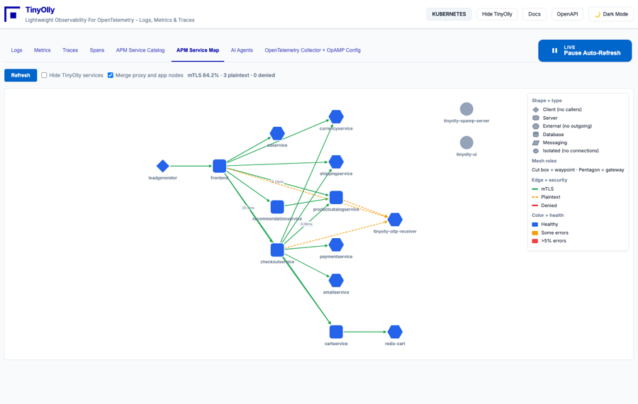
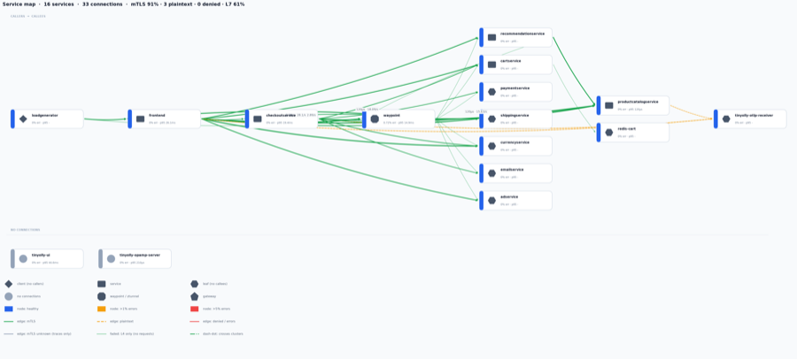
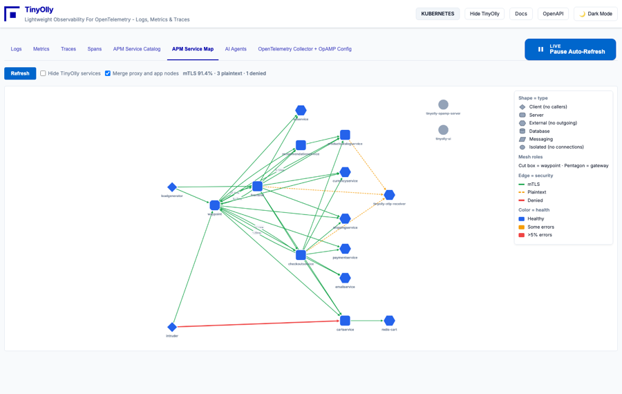
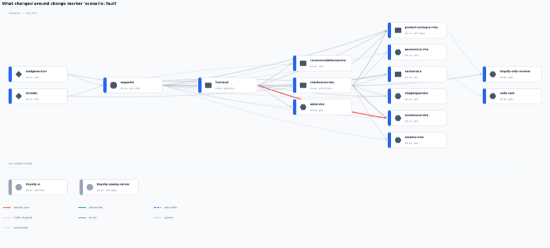

<div align="center">

# Istio ambient + TinyOlly demo

**See Istio's sidecar-less "ambient" service mesh working on a Mac.**<br>
Encrypted traffic, policy enforcement, canary rollouts and request-level detail, drawn live in
[TinyOlly](https://github.com/tinyolly/tinyolly) and queryable by an AI assistant through its MCP server.


[](docs/images/full/step1-map.png)

</div>

## What you will see

- A live service map of [Online Boutique](https://github.com/GoogleCloudPlatform/microservices-demo) (11 microservices) built from mesh metrics alone, with **no sidecars** and no app changes.
- mTLS coverage, plaintext gaps and denied calls on the map.
- Layer 7 added only where you ask for it (one service, then the whole namespace), with traces appearing when you do.
- A 90/10 canary, an authorization policy blocking an intruder, STRICT mTLS refusing an outsider, plus fault injection and retries.
- The same data answered in plain English by an AI assistant (see [Ask an AI about the mesh](#ask-an-ai-about-the-mesh)).

```text
 browser :5001 ──▶ Istio ingress gateway ──▶ Online Boutique pods (no sidecars)
                                                  │  traffic is tunnelled by ztunnel (per node): mTLS + L4 metrics
                                                  │  optional waypoint (Envoy): L7 routing, policy, traces
                                                  ▼
       mesh-metrics collector ──OTLP──▶ TinyOlly (map, posture, metrics, traces) ◀──MCP──▶ AI assistant
                                                  :5005 UI                        :8765
```

**Contents:** [Why ambient](#why-ambient-exists) · [Prerequisites](#prerequisites) · [Setup](#setup) · [Demo guide](#demo-guide) · [Ask an AI](#ask-an-ai-about-the-mesh) · [Metrics guide](#metrics-guide) · [Troubleshooting](#troubleshooting) · [Docs](#docs)

<details>
<summary><b>Glossary</b> (new to service meshes? start here)</summary>

- **Ambient mode:** the newer Istio model with no sidecars. Proxies run per node or per namespace instead.
- **Authorization policy:** a rule like "only checkout may call EmptyCart".
- **Istio:** the most popular open-source service mesh. Runs on Kubernetes.
- **Kubernetes:** the system that runs and manages containerized apps. A **pod** is one running instance of a service. A **node** is one machine (or VM) in the cluster.
- **L4 vs L7:** L4 is the connection level (who connects to whom, bytes). L7 is the request level (HTTP/gRPC paths, headers, status codes).
- **mTLS (mutual TLS):** both sides prove their identity and the traffic is encrypted. "Mutual" means the server checks the client too.
- **OpenTelemetry (OTel):** the open standard for emitting telemetry.
- **Proxy:** a small program that sits between two services and handles their traffic. **Envoy** is the proxy Istio uses.
- **Retries, timeouts, fault injection:** automatically re-try failed calls, cap how long calls can take, and deliberately inject errors or delays to test resilience.
- **Service mesh:** a layer that handles how services talk to each other (security, routing, retries, metrics) so app code doesn't have to.
- **Sidecar:** the old Istio model, where an Envoy proxy runs inside every pod next to the app.
- **Telemetry:** metrics, traces and logs that show what the system is doing. A **trace** is the recorded path of one request across services.
- **TinyOlly:** a lightweight observability tool that receives OTel data and draws the service map.
- **Waypoint:** an optional Envoy proxy you add for a namespace or service when you need smarter, request-level features.
- **Zero trust:** don't trust traffic just because it's inside your network. Verify identity and permissions on every call.
- **ztunnel:** ambient's small per-node proxy. It encrypts traffic and identifies workloads, but only at the connection level.

</details>

## Why ambient exists

- **Problem with sidecars:** every pod carries its own proxy. That costs CPU and memory, adds delay, and makes upgrades awkward because pods must restart. It's also intrusive for app teams.
- **Goal:** keep the mesh benefits (encryption, identity, policy, visibility) with much less overhead.
- **How:**
  - **Cheap secure base:** ztunnel gives every workload mTLS and connection-level policy.
  - **Pay for L7 only where needed:** waypoints add request-level routing, retries and policy for the services that need them.

**What a company gets from a mesh**
- **Zero trust:** encrypted, identity-based traffic between services, with rules like "only checkout may call EmptyCart".
- **Resilience:** retries, timeouts and fault injection without changing app code.
- **Safe rollouts:** send a small share of traffic to a new version and compare it.
- **Uniform visibility:** the same telemetry for every service, whatever language it's written in.

**Why this demo:** ambient is easy to describe but hard to see, because ztunnel is invisible. TinyOlly makes it visible: topology from ztunnel metrics, mTLS and plaintext on the map, denied calls as red edges, and traces appearing when a waypoint is added. A mesh is more than a load balancer: a load balancer decides where a request goes, a mesh also decides whether it is allowed, encrypts it, retries it, and records what happened.

## Prerequisites

- A Mac with Colima, kind, kubectl, helm and Docker (about 6 GiB for the Colima VM: 4 CPU / 6 GiB is enough).
- A checkout of the [TinyOlly repo](https://github.com/tinyolly/tinyolly) (v3.0.0 or later). The demo runs on its kind cluster `tinyolly` and needs TinyOlly's mesh features (metric-derived edges, roles, posture).
- Optional: an MCP client (Claude Code or Claude Desktop) for the AI prompts.

> [!NOTE]
> If you build TinyOlly from source, build the shared `python-base` image **before** the UI image, with `DOCKER_CONTEXT=colima-tinyolly`:
>
> ```bash
> docker build -t tinyolly/python-base:latest -f docker/dockerfiles/Dockerfile.tinyolly-python-base docker/
> k8s/04-rebuild+deploy-ui.sh
> ```

## Setup

```bash
# 1. In the tinyolly repo: start the cluster and TinyOlly
./scripts/colima-up.sh && ./scripts/kind-up.sh
k8s/02-deploy-tinyolly.sh

# 2. In this repo
./01-deploy-istio.sh        # Istio ambient + the mesh-metrics collector
./02-deploy-shop.sh         # Online Boutique in the mesh
./05-enable-tracing.sh      # app traces into TinyOlly
```

| Script | What it does |
|---|---|
| `01-deploy-istio.sh` | Installs the Gateway API CRDs and Istio ambient from Helm (base, istiod, CNI, ztunnel), then deploys `mesh-metrics.yaml`: a collector that scrapes ztunnel and waypoint metrics every 15 s and forwards them to TinyOlly |
| `02-deploy-shop.sh` | Deploys Online Boutique into the `boutique` namespace, labelled `istio.io/dataplane-mode=ambient` (that one label joins the mesh: no restart, no injection), plus an ingress Gateway on port 5001. It raises the memory limit of `cartservice` and `currencyservice` to 256Mi and lowers every pod's CPU request to 50m so the whole demo fits a 4-CPU kind node. This is **L4 only**: no waypoint yet |
| `05-enable-tracing.sh` | Turns on OpenTelemetry tracing in the Go services (frontend, checkout, product catalog, shipping), exporting to TinyOlly |
| `03-scenario.sh <name>` | Applies one scenario from the demo guide below |
| `04-cleanup.sh` | Removes the shop, waypoint, collector and Istio, and clears TinyOlly's stored telemetry. Leaves the kind cluster and TinyOlly itself in place |

> [!TIP]
> **Clean start (before every run):** `./03-scenario.sh fresh` removes any scenario, restarts ztunnel (its counters count from when it started, so old denied and plaintext history would otherwise reappear) and clears TinyOlly's stored telemetry. The map refills in about 1 to 2 minutes.

**Open:** the shop at <http://localhost:5001> and TinyOlly at <http://localhost:5005> → **APM Service Map**. A load generator keeps traffic flowing, so the map fills in within about a minute. Versions are pinned in `versions.env`.

**Optional, for the AI prompts:** TinyOlly runs its MCP server as a pod next to the UI on `http://localhost:8765/mcp`.

```bash
claude mcp add --transport http tinyolly http://127.0.0.1:8765/mcp     # Claude Code
```

Claude Desktop connects through `mcp-remote`: see the [TinyOlly MCP docs](https://github.com/tinyolly/tinyolly/blob/main/docs/mcp.md).

## Demo guide

About 15 minutes. Each step says what to run, **what it does**, and what to **look at** in TinyOlly. Run `./03-scenario.sh fresh` first, and again between rehearsals. The screenshots come from a real run (`./make-screenshots.py` regenerates them); click one to enlarge.

<details>
<summary><b>How to read the map</b></summary>

- **Cards** are services. The small icon is the role: diamond = client (nothing calls it), rounded box = service, hexagon = external (it calls nothing), cut-corner box = waypoint or ztunnel, pentagon = gateway.
- **Card stripe** is health: blue healthy, amber above 1% errors, red above 5%.
- **Edges** are calls. Green solid = mTLS, orange dashed = plaintext, red = denied or failing. Thickness is volume.
- **The bar above the map** summarizes posture: for example `mTLS 92.5% · 3 plaintext · 0 denied`.

</details>

### Step 1 · The mesh with no sidecars (L4 only)

**Run:** nothing yet. Open the map and let it fill in.

- **What it does:** every pod is in the mesh because its namespace is labelled, but there is no proxy in the pods. A **ztunnel** on each node encrypts traffic with mTLS using each workload's identity, and exports connection-level metrics. TinyOlly turns those metrics into the map.
- **Look at:** the whole map appears from metrics alone, with no traces (ztunnel produces none). Edges are green: mTLS for free. There are no request rates, latency or errors yet: that is the L4 limit.

### Step 2 · Security posture

**Run:** nothing. Read the bar and the orange dashed edges.

- **What it does:** TinyOlly reads `connection_security_policy` on each connection. `mutual_tls` is green. Anything else is plaintext.
- **Look at:** roughly 80 to 92% mTLS (it rises as more of the map fills in). The orange edges go to `tinyolly-otlp-receiver`: the apps export telemetry to a service outside the mesh. That is a real zero-trust gap, found without reading any config.

### Step 3 · Enforce mTLS

```bash
./03-scenario.sh outsider     # then wait a minute
./03-scenario.sh strict
```

- **What it does:** `outsider` starts a pod in a namespace that is not in the mesh and has it call `frontend` over plaintext. By default the mesh accepts that. `strict` applies a `PeerAuthentication` with mode STRICT, and ztunnel then refuses any connection that is not mTLS.
- **Look at:** first an `outsider → frontend` orange plaintext edge, and the outsider's own log (`kubectl -n outside logs outsider`) shows `200`. After `strict`, the edge turns red, the bar counts it as denied (ztunnel flags these `DENY`), and the log shows `000` (refused).

| Before: plaintext, accepted | After `strict`: denied |
|:---:|:---:|
| [](docs/images/full/step3-plaintext.png) | [](docs/images/full/step3-denied.png) |

> [!IMPORTANT]
> Run this step **before any waypoint**: a workload behind a waypoint also refuses direct plaintext, so the "before" would fail too. Clear it with `./03-scenario.sh fresh` (a plain `reset` leaves the old outsider edge on the map).

### Step 4 · Layer 7 only where you need it

```bash
./03-scenario.sh waypoint-svc currencyservice
```

- **What it does:** deploys a **waypoint** (an Envoy proxy) and attaches it to one Service. Only calls to `currencyservice` now go through it. Everything else stays L4. The script then deletes the caller pods (frontend, checkout, recommendation) so they restart: their long-lived gRPC connections keep the path they were opened on, so without that the waypoint would see no traffic. The shop is briefly unavailable (about 30 seconds). Pods are deleted rather than rolled because a rolling restart needs spare CPU for the replacement pod.
- **Look at:** the waypoint node appears. Only edges into `currencyservice` gain request-level metrics (rates, latency, response codes) and traces. The rest of the map is unchanged. This is "pay for L7 only where you need it".

### Step 5 · Layer 7 for the namespace

```bash
./03-scenario.sh waypoint
```

- **What it does:** attaches the same waypoint to the whole `boutique` namespace.
- **Look at:** every service-to-service call now has latency and status codes, and traces stitch through the waypoint (ingress → frontend → waypoint → services). Untick **Merge proxy and app nodes** to see the layered view of proxies and apps.

[](docs/images/full/step5-waypoint.png)

### Step 6 · Canary rollout

```bash
./03-scenario.sh canary
```

- **What it does:** deploys `productcatalogservice` v2 (it adds 400 ms of latency) next to v1, then applies a Gateway API route that sends 90% of calls to v1 and 10% to v2. The waypoint does the splitting; no app changes.
- **Look at:** after a minute or two, v1 gets about 90% of requests and v2 about 10%. v1 averages well under a millisecond and v2 about 400 ms. The MCP tool `get_version_split` reports share, errors and average latency per version (prompts below). A real rollout would use this to decide whether to shift more traffic.

### Step 7 · Authorization policy

```bash
./03-scenario.sh authz
./03-scenario.sh probe        # runs for about 2 minutes
```

- **What it does:** `authz` applies two policies: only `cartservice` may reach redis (L4, enforced by ztunnel), and only `checkoutservice` may call `EmptyCart` on port 7070 (L7, enforced by the waypoint). `probe` starts an `intruder` pod that calls `EmptyCart` repeatedly.
- **Look at:** a red edge from `intruder` to `cartservice` and `1 denied` in the bar (the count grows while the probe runs). gRPC reports a policy denial as HTTP 200 with `grpc-status 7`, so TinyOlly reads that status, not just the HTTP code. With the waypoint on, you may also see a small red `waypoint → redis-cart` edge: redis only trusts `cartservice`, and the policy correctly refuses the waypoint's identity.

[](docs/images/full/step7-authz.png)

### Step 8 · Resilience (optional)

```bash
./03-scenario.sh fault
./03-scenario.sh timeout      # after canary
./03-scenario.sh flaky
./03-scenario.sh retry        # after flaky
```

- **`fault`** delays 50% of calls to `currencyservice` by 2 seconds. The mesh injects the delay, so the shop itself gets slow (the home page takes several seconds): that is the effect.
- **`timeout`** adds a 200 ms request timeout to the canary route. The slow v2 (400 ms) is now cut off while v1 is unaffected. Run it after `canary`. (A route timeout does not cut off a delay injected by `fault`, which is why it targets the canary.)
- **`flaky`** adds a pod that carries the `productcatalogservice` label but never listens on its port, so about half the calls to that service fail. It removes the `canary` route first, because that route bypasses the pod.
- **`retry`** sets 3 attempts, a 2 s timeout per try and a 6 s overall timeout on `productcatalogservice`, for failed calls (5xx, resets, connect failures). It does not retry timeouts.

**Look at:** after `fault`, average latency into `currencyservice` jumps from about a millisecond to about 900 ms. After `timeout`, calls to v2 fail (response flag `UT`) and errors appear on the edges into `productcatalogservice`. After `flaky`, about half the calls into `productcatalogservice` fail with response flag `UC` and the shop returns errors. After `retry`, a failed attempt goes to another endpoint: the flag disappears and every request succeeds. The mesh metrics report only the final result, so the proof of a retry is that the failures vanish.

[](docs/images/full/step8-fault-diff.png)

### Step 9 · Let an AI investigate (optional)

With the waypoint on, apply the flaky scenario and wait about a minute:

```bash
./03-scenario.sh waypoint
./03-scenario.sh flaky
```

Then ask your assistant:

> Something is wrong with the shop. Investigate and tell me which service and why.

- **What it does:** `03-scenario.sh` records a change marker in TinyOlly each time it applies something. The assistant calls `what_changed` (the marker and what happened to failures after it), then `get_edge` (the edge carries response flag `UC`, with its meaning and a next step), and can draw `chart_map_diff` (red edges got more failures).
- **Look at:** the answer should name `productcatalogservice`, say about half the calls fail because the upstream closes the connection, and point at the pod that is Ready but not listening. Now run `./03-scenario.sh retry`: ask again and the failures are gone.
- **Why it matters:** the same fault, injected the same way, is what TinyOlly's agent eval (`scripts/agent_eval/` in the TinyOlly repo) scores local models against.

### Reset

`./03-scenario.sh reset` removes every scenario and the waypoint; `./03-scenario.sh fresh` also clears the history. `./04-cleanup.sh` removes the demo entirely.

### Quick reference

| Command | Effect |
|---|---|
| `./03-scenario.sh outsider` / `strict` | Plaintext client outside the mesh / require mTLS (run before any waypoint) |
| `./03-scenario.sh waypoint-svc [service]` | L7 for one service only (default `productcatalogservice`) |
| `./03-scenario.sh waypoint` | L7 for the whole namespace |
| `./03-scenario.sh canary` | 90/10 split between v1 and a slower v2 |
| `./03-scenario.sh authz` / `probe` | Deny policies / an intruder that trips them |
| `./03-scenario.sh fault` / `flaky` / `retry` | Inject delay / break half the calls / retry failed calls |
| `./03-scenario.sh timeout` | Cut off the slow canary v2 at 200 ms (run after `canary`) |
| `./03-scenario.sh reset` / `fresh` | Remove all scenarios / also zero ztunnel's counters and clear TinyOlly's history |

## Ask an AI about the mesh

TinyOlly's MCP server lets an assistant query the same data. After setting it up (see [Setup](#setup)), try these prompts. The MCP tool or playbook behind each one is on the right.

**Map and posture**

| Prompt | Tool |
|---|---|
| "Show me the service map and explain what each shape and color means." | `chart_service_map` |
| "What is the mesh posture? How much traffic is mTLS and which edges are plaintext?" | `get_mesh_posture` |
| "Which edges are plaintext, and why?" | `find_plaintext` |
| "Draw the neighbourhood of the waypoint, two hops out." | `chart_service_map` |

**Security**

| Prompt | Tool |
|---|---|
| "Is anything being denied? Who called what, and how many times?" | `find_denied` |
| "Who is the intruder calling and which policy blocks it?" | `find_denied`, `get_edge` |
| "Explain the edge from frontend to cartservice: counts, errors, latency and whether it is mTLS." | `get_edge` |

**Lock it down**

| Prompt | Tool |
|---|---|
| "Draft a least-privilege policy for cartservice from the callers you actually see. Which callers would it block?" | `suggest_authz` |
| "Which edges only have connection counts, and where would a waypoint add the most?" | `get_mesh_posture` (L7 coverage, L4-only edges) |

**Rollouts and comparisons**

| Prompt | Tool |
|---|---|
| "Show me the traffic split for productcatalogservice. How much slower is v2 than v1?" | `get_version_split` |
| "Compare the last 5 minutes with the 5 minutes before: what changed in errors and latency for frontend?" | `compare_windows` |
| "Did the fault scenario change anything? Which service got slower?" | `compare_windows`, `get_service_map` |
| "What changed around the last scenario I applied?" | `what_changed` (`03-scenario.sh` records a change marker each time) |
| "Show me on the map what the flaky scenario broke." | `chart_map_diff` (red edges got more failures) |

**Latency, errors and traces**

| Prompt | Tool |
|---|---|
| "Group istio_requests_total by response code for traffic into cartservice." | `query_metric` |
| "Find the slowest checkout trace. How much time was the mesh and how much was the app?" | `search_traces`, `get_trace_mesh` |
| "Draw the journey of that trace over the map. How much of the time was spent in the mesh?" | `chart_trace_path` |
| "Why is checkout slow? Follow the mesh investigation playbook." | `get_skill` → `tinyolly-mesh-investigation` |

**Learning**

| Prompt | Tool |
|---|---|
| "What does ztunnel do, and how does TinyOlly build this map without traces?" | `search_docs` |
| "List the investigation playbooks you have for this mesh." | `list_skills` |

> [!TIP]
> **A good five-minute demo with an AI:** run Step 7, then ask "Is anything being denied in the mesh?", then "Explain that edge", then "Chart the neighbourhood of cartservice". Three prompts take you from an alert to the cause and a picture.

## Metrics guide

A collector (`mesh-metrics.yaml`) scrapes every ztunnel and waypoint pod every 15 seconds and sends the Istio metrics to TinyOlly over OTLP. TinyOlly draws the map and the mTLS / denied posture from them.

Metric types:
- **Counter:** a number that only goes up (resets on restart), such as total requests. Look at its rate of change, not the raw value.
- **Gauge:** a value that goes up and down, such as connections open right now. Read it as it is.
- **Histogram:** counts of observations in buckets (for example how many requests took under 10 ms, under 50 ms), which lets you compute percentiles like p95.

| Metric | Type | From | What it tells you |
|---|---|---|---|
| `istio_tcp_connections_opened_total` / `_closed_total` / `_failed_total` | counter | ztunnel, waypoint | Who connected to whom. The base of the map, available with no waypoint |
| `istio_tcp_sent_bytes_total` / `istio_tcp_received_bytes_total` | counter | ztunnel, waypoint | Bytes each way |
| `istio_tcp_sockets_open` | gauge | ztunnel | Connections open right now |
| `istio_requests_total` | counter | waypoint | HTTP/gRPC requests by response code (errors, denials). Needs a waypoint |
| `istio_request_duration_milliseconds` | histogram | waypoint | Request latency (p50 / p95 / p99) |
| `istio_request_bytes` / `istio_response_bytes` | histogram | waypoint | Request and response sizes |

Labels to look at:
- **Who:** `source_workload`, `destination_workload` (and `_canonical_service`, namespaces).
- **Encrypted?** `connection_security_policy`: `mutual_tls` means mTLS; `unknown` means no mTLS was seen (for example a destination outside the mesh), which TinyOlly shows as plaintext.
- **Outcome:** `response_code` (HTTP status), `grpc_response_status` (`7` = permission denied) and `response_flags` (Envoy's reason code, `-` for none).

| Question | Look at |
|---|---|
| Who talks to whom? | TCP connections by source and destination workload |
| Is everything encrypted? | `connection_security_policy` (TinyOlly's posture bar shows the percentage) |
| What is being denied? | `istio_requests_total` with `response_code=403` or `grpc_response_status=7` (red edges) |
| Is a service slow? | `istio_request_duration_milliseconds` p95 by destination |
| Did a scenario change anything? | Compare p95 and error rate before and after `./03-scenario.sh` |

Without a waypoint you only get the TCP metrics. Add one with `./03-scenario.sh waypoint` to get request rates, errors and latency. Details and caveats: [docs/METRICS.md](docs/METRICS.md).

## Troubleshooting

- **The map is empty or sparse:** give it a minute for the first scrape (the collector scrapes every 15 s). Check the load generator and mesh pods are running:

    ```bash
    kubectl get pods -A | grep -E "loadgenerator|ztunnel"
    ```

- **Mesh features are missing in the UI (no posture bar, no roles):** the UI image is stale. Rebuild `python-base` first, then the UI image (see [Prerequisites](#prerequisites)).
- **Pods stay `Pending` with `Insufficient cpu`:** the kind node has 4 CPUs. `02-deploy-shop.sh` lowers the shop's CPU requests to make room; if you added workloads, free some CPU or give Colima more (`COLIMA_CPU`).
- **The shop returns 500 or pages hang:** check for a restarting pod:

    ```bash
    kubectl -n boutique get pods
    ```

    `cartservice` and `currencyservice` are given 256Mi by `02-deploy-shop.sh` (the default 128Mi runs out under sustained load).

- **Denied or plaintext edges from an earlier run are still on the map:** run `./03-scenario.sh fresh`. ztunnel's counters count from when it started, so a plain `reset` keeps the history.
- **A waypoint is on but the map shows no L7 data:** callers must reconnect to use it. The scenarios restart them for you; if you attached a waypoint by hand, restart the callers.
- **`outsider` and `strict` show nothing different:** a waypoint is active. Run `./03-scenario.sh reset` and repeat Step 3 before adding any waypoint.
- **A scenario says the waypoint is missing:** run `./03-scenario.sh waypoint` or `waypoint-svc` first. `fault`, `flaky`, `retry`, `canary` and the L7 half of `authz` need it.
- **MCP tools look old in Claude Desktop:** a per-client copy of the server is running old code. Point it at the pod with `mcp-remote` and restart the app.

## Docs

| File | What is in it |
|---|---|
| [`docs/PLAN.md`](docs/PLAN.md) | Demo plan and spike findings |
| [`docs/AMBIENT-NOTES.md`](docs/AMBIENT-NOTES.md) | Ambient notes and glossary |
| [`docs/METRICS.md`](docs/METRICS.md) | Mesh metrics guide |
| [`docs/DELEGATION.md`](docs/DELEGATION.md) | How this repo uses local Qwen for mechanical work |

Checks: `check_scenarios.py` validates the scenario manifests (needs PyYAML and the kind cluster). `test-demo.py` runs the whole walkthrough (Steps 1 to 8) against a running cluster and asserts what TinyOlly shows; it takes about 25 minutes and ends with `reset`. `make-screenshots.py` regenerates the screenshots.
